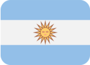
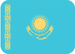
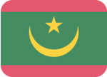
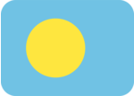
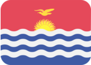

# ip-country-ranking

Country-ranked global IP statistics, based on data from [MaxMind's GeoLite2](https://dev.maxmind.com/geoip/geoip2/geolite2/)

## IP Count (Sorted by IPv4 Count)

Country names follow the naming convention from [ppy/osu](https://github.com/ppy/osu), and flags are sourced from [Twemoji](https://github.com/twitter/twemoji) 14.0.2 assets

| ISO | Flag | Country | IPv4 Blocks | IPv4 Count | IPv6 Blocks | IPv6 Count |
| :---: | :---: | --- | :---: | :---: | :---: | :---: |
| US |  | United States | 128,604 | 1,511,052,509 | 132,481 | 1.18e+34 |
| CN |  | China | 7,919 | 345,275,740 | 11,499 | 5.43e+33 |
| JP |  | Japan | 12,434 | 199,957,798 | 5,330 | 8.15e+32 |
| DE |  | Germany | 30,511 | 135,682,706 | 42,817 | 1.97e+33 |
| GB |  | United Kingdom | 36,516 | 129,241,819 | 14,235 | 1.72e+33 |
| KR |  | South Korea | 4,001 | 116,259,217 | 1,589 | 4.19e+32 |
| BR |  | Brazil | 11,462 | 85,395,355 | 12,589 | 6.76e+32 |
| FR |  | France | 33,606 | 83,529,596 | 6,749 | 1.22e+33 |
| CA |  | Canada | 17,621 | 72,577,807 | 9,804 | 1.17e+32 |
| IT |  | Italy | 10,018 | 57,277,991 | 3,589 | 8.58e+32 |
| NL |  | Netherlands | 18,949 | 54,657,192 | 59,115 | 8.55e+32 |
| AU |  | Australia | 11,821 | 53,042,656 | 6,273 | 7.80e+32 |
| IN |  | India | 13,659 | 48,914,576 | 7,754 | 5.42e+32 |
| RU |  | Russian Federation | 13,312 | 45,732,540 | 12,184 | 8.76e+32 |
| TW |  | Taiwan | 2,459 | 37,188,849 | 2,426 | 2.07e+32 |
| ES |  | Spain | 11,646 | 35,524,005 | 3,118 | 4.56e+32 |
| SE |  | Sweden | 10,295 | 32,257,048 | 4,045 | 5.55e+32 |
| MX |  | Mexico | 4,355 | 30,863,083 | 1,880 | 6.30e+31 |
| ZA |  | South Africa | 3,979 | 29,093,871 | 1,567 | 4.27e+32 |
| SG |  | Singapore | 9,805 | 28,231,443 | 4,763 | 2.74e+33 |
| CH |  | Switzerland | 6,590 | 24,809,544 | 5,310 | 3.29e+32 |
| EG |  | Egypt | 784 | 24,215,677 | 211 | 3.27e+32 |
| HK |  | Hong Kong | 11,264 | 22,899,460 | 4,710 | 1.81e+32 |
| PL |  | Poland | 8,450 | 21,109,195 | 3,353 | 5.06e+32 |
| ID |  | Indonesia | 6,816 | 20,228,767 | 4,338 | 6.75e+31 |
| AR |  | Argentina | 3,617 | 19,727,527 | 2,142 | 4.22e+32 |
| IE |  | Ireland | 5,170 | 18,262,896 | 4,306 | 8.72e+31 |
| CO |  | Colombia | 2,324 | 17,972,354 | 1,534 | 3.44e+31 |
| TR |  | Türkiye | 3,571 | 17,375,152 | 1,896 | 3.68e+32 |
| VN |  | Vietnam | 2,265 | 16,760,119 | 1,608 | 3.47e+31 |
| NO |  | Norway | 3,247 | 16,374,688 | 1,162 | 1.81e+32 |
| FI |  | Finland | 3,642 | 14,966,059 | 42,991 | 1.18e+32 |
| BE |  | Belgium | 5,761 | 14,651,224 | 1,543 | 1.34e+32 |
| DK |  | Denmark | 3,945 | 12,652,383 | 1,135 | 1.65e+32 |
| SA |  | Saudi Arabia | 1,807 | 12,489,496 | 825 | 5.01e+31 |
| MA |  | Morocco | 513 | 12,304,824 | 202 | 2.15e+31 |
| AT |  | Austria | 4,594 | 11,408,347 | 2,343 | 1.95e+32 |
| IR |  | Islamic Republic of Iran | 2,071 | 10,963,049 | 691 | 3.22e+32 |
| CL |  | Chile | 1,994 | 10,512,149 | 7,621 | 2.36e+31 |
| TH |  | Thailand | 2,099 | 10,080,878 | 1,512 | 9.71e+30 |
| UA |  | Ukraine | 5,417 | 9,428,929 | 2,490 | 2.17e+32 |
| IL |  | Israel | 2,524 | 8,901,216 | 1,756 | 8.07e+31 |
| CZ |  | Czechia | 3,747 | 8,757,582 | 2,005 | 2.45e+32 |
| MY |  | Malaysia | 2,631 | 8,024,407 | 1,358 | 1.51e+31 |
| TN |  | Tunisia | 228 | 7,882,396 | 108 | 2.06e+30 |
| VE |  | Venezuela | 1,001 | 7,718,696 | 636 | 4.08e+31 |
| RO |  | Romania | 4,110 | 7,489,352 | 1,284 | 9.89e+31 |
| NZ |  | New Zealand | 2,320 | 7,377,632 | 1,581 | 2.41e+31 |
| PT |  | Portugal | 2,076 | 6,898,397 | 1,138 | 5.53e+31 |
| PH |  | Philippines | 2,231 | 6,747,851 | 1,050 | 1.83e+31 |
| AE |  | United Arab Emirates | 4,012 | 6,559,826 | 2,505 | 3.06e+32 |
| KE |  | Kenya | 923 | 6,389,299 | 398 | 1.25e+31 |
| HU |  | Hungary | 1,823 | 5,960,497 | 1,024 | 5.96e+31 |
| GR |  | Greece | 1,553 | 5,944,145 | 996 | 4.40e+31 |
| PK |  | Pakistan | 1,445 | 5,935,607 | 608 | 1.61e+31 |
| DZ |  | Algeria | 222 | 4,780,126 | 185 | 7.14e+29 |
| BG |  | Bulgaria | 2,373 | 4,299,689 | 882 | 9.50e+31 |
| SC |  | Seychelles | 2,820 | 4,051,246 | 2,112 | 3.40e+32 |
| PE |  | Peru | 1,130 | 3,665,534 | 793 | 1.75e+31 |
| KZ |  | Kazakhstan | 1,355 | 3,555,796 | 1,014 | 4.45e+31 |
| NG |  | Nigeria | 1,171 | 3,278,906 | 506 | 1.13e+31 |
| LT |  | Lithuania | 1,504 | 3,041,235 | 2,886 | 1.45e+32 |
| EC |  | Ecuador | 789 | 2,894,285 | 553 | 2.03e+31 |
| SK |  | Slovakia | 1,175 | 2,794,171 | 739 | 5.34e+31 |
| SI |  | Slovenia | 1,066 | 2,652,739 | 467 | 3.94e+31 |
| UY |  | Uruguay | 288 | 2,492,887 | 139 | 3.18e+30 |
| MU |  | Mauritius | 388 | 2,484,263 | 255 | 1.59e+30 |
| HR |  | Croatia | 847 | 2,465,818 | 316 | 2.89e+31 |
| CR |  | Costa Rica | 603 | 2,374,012 | 337 | 7.87e+30 |
| RS |  | Serbia | 1,017 | 2,332,131 | 376 | 3.35e+31 |
| GH |  | Ghana | 362 | 2,219,517 | 220 | 2.27e+31 |
| BD |  | Bangladesh | 2,935 | 2,188,817 | 2,127 | 5.84e+31 |
| LV |  | Latvia | 1,260 | 2,142,833 | 455 | 2.71e+31 |
| DO |  | Dominican Republic | 671 | 2,077,795 | 410 | 1.62e+31 |
| KW |  | Kuwait | 468 | 1,931,830 | 672 | 1.60e+31 |
| SD |  | Sudan | 125 | 1,898,060 | 81 | 1.19e+30 |
| BY |  | Belarus | 423 | 1,888,625 | 336 | 1.28e+31 |
| PA |  | Panama | 596 | 1,793,909 | 389 | 9.60e+30 |
| CI |  | Cote D'Ivoire | 351 | 1,712,314 | 118 | 3.50e+30 |
| ZM |  | Zambia | 172 | 1,657,372 | 99 | 7.93e+29 |
| EE |  | Estonia | 1,120 | 1,619,158 | 601 | 5.90e+31 |
| UG |  | Uganda | 261 | 1,465,171 | 125 | 2.14e+30 |
| LU |  | Luxembourg | 1,537 | 1,437,257 | 391 | 3.96e+31 |
| SY |  | Syrian Arab Republic | 312 | 1,317,813 | 84 | 1.62e+31 |
| QA |  | Qatar | 491 | 1,317,373 | 330 | 8.43e+30 |
| AO |  | Angola | 421 | 1,308,055 | 172 | 3.25e+30 |
| GE |  | Georgia | 481 | 1,300,694 | 271 | 3.68e+31 |
| MD |  | Moldova | 799 | 1,292,803 | 1,954 | 1.24e+32 |
| PY |  | Paraguay | 479 | 1,283,398 | 210 | 7.53e+30 |
| PR |  | Puerto Rico | 805 | 1,279,006 | 239 | 4.13e+30 |
| CY |  | Cyprus | 859 | 1,237,285 | 664 | 2.09e+32 |
| BO |  | Bolivia | 408 | 1,217,978 | 178 | 2.93e+30 |
| TZ |  | United Republic of Tanzania | 341 | 1,137,596 | 189 | 4.68e+30 |
| OM |  | Oman | 346 | 1,120,986 | 279 | 1.02e+31 |
| IS |  | Iceland | 386 | 940,140 | 443 | 2.66e+31 |
| BH |  | Bahrain | 264 | 920,336 | 194 | 7.32e+30 |
| PS |  | State of Palestine | 310 | 857,420 | 152 | 1.81e+31 |
| IQ |  | Iraq | 700 | 838,810 | 940 | 5.85e+31 |
| XX |  | Unknown | 770 | 833,416 | 730 | 3.13e+30 |
| BA |  | Bosnia and Herzegovina | 314 | 827,123 | 143 | 1.35e+31 |
| AZ |  | Azerbaijan | 423 | 789,632 | 256 | 3.42e+31 |
| SV |  | El Salvador | 288 | 712,183 | 157 | 3.49e+30 |
| MK |  | North Macedonia | 288 | 710,963 | 132 | 1.89e+31 |
| GT |  | Guatemala | 529 | 709,045 | 236 | 5.71e+30 |
| MT |  | Malta | 310 | 679,097 | 113 | 8.18e+30 |
| RE |  | Reunion | 226 | 668,593 | 91 | 2.15e+30 |
| JO |  | Jordan | 450 | 665,341 | 170 | 2.04e+31 |
| CM |  | Cameroon | 180 | 604,464 | 107 | 1.26e+30 |
| AM |  | Armenia | 349 | 603,134 | 426 | 2.38e+31 |
| NP |  | Nepal | 467 | 599,969 | 284 | 6.42e+30 |
| LK |  | Sri Lanka | 266 | 591,617 | 955 | 1.27e+30 |
| LB |  | Lebanon | 400 | 589,153 | 228 | 5.35e+31 |
| MG |  | Madagascar | 100 | 588,277 | 89 | 4.02e+29 |
| MW |  | Malawi | 121 | 559,834 | 99 | 2.28e+31 |
| TT |  | Trinidad and Tobago | 161 | 550,215 | 114 | 2.54e+30 |
| KH |  | Cambodia | 532 | 498,671 | 215 | 4.91e+30 |
| HN |  | Honduras | 382 | 496,008 | 235 | 6.66e+30 |
| LY |  | Libya | 152 | 486,675 | 78 | 1.27e+30 |
| MZ |  | Mozambique | 175 | 475,800 | 93 | 1.19e+30 |
| NA |  | Namibia | 144 | 464,423 | 78 | 5.53e+29 |
| NI |  | Nicaragua | 193 | 444,652 | 97 | 1.59e+30 |
| VG |  | Virgin Islands, British | 255 | 430,588 | 331 | 1.60e+31 |
| SN |  | Senegal | 135 | 417,298 | 99 | 4.77e+29 |
| UZ |  | Uzbekistan | 555 | 416,385 | 224 | 2.12e+31 |
| BF |  | Burkina Faso | 139 | 413,298 | 108 | 1.67e+30 |
| GA |  | Gabon | 81 | 386,790 | 65 | 5.55e+29 |
| MO |  | Macau | 125 | 379,691 | 628 | 7.14e+29 |
| ET |  | Ethiopia | 112 | 373,359 | 85 | 2.06e+31 |
| TG |  | Togo | 83 | 357,351 | 61 | 4.76e+29 |
| AL |  | Albania | 391 | 349,007 | 1,065 | 4.70e+31 |
| RW |  | Rwanda | 113 | 319,541 | 82 | 2.12e+31 |
| KG |  | Kyrgyzstan | 253 | 300,956 | 176 | 1.02e+31 |
| JM |  | Jamaica | 242 | 281,669 | 120 | 2.07e+31 |
| MM |  | Myanmar | 456 | 280,513 | 322 | 6.10e+30 |
| GM |  | Gambia | 83 | 279,064 | 72 | 7.14e+29 |
| GP |  | Guadeloupe | 224 | 273,159 | 80 | 8.80e+29 |
| ZW |  | Zimbabwe | 241 | 263,727 | 125 | 1.27e+30 |
| CU |  | Cuba | 92 | 258,535 | 83 | 4.81e+29 |
| MQ |  | Martinique | 187 | 248,947 | 58 | 2.15e+30 |
| GU |  | Guam | 166 | 241,457 | 100 | 6.35e+29 |
| YE |  | Yemen | 137 | 239,349 | 93 | 3.80e+30 |
| BN |  | Brunei | 123 | 222,280 | 76 | 4.76e+29 |
| CD |  | The Democratic Republic of the Congo | 243 | 221,103 | 140 | 2.78e+30 |
| ME |  | Montenegro | 145 | 197,247 | 98 | 7.92e+30 |
| CW |  | Curaçao | 121 | 194,641 | 85 | 2.85e+30 |
| MN |  | Mongolia | 254 | 187,115 | 238 | 2.46e+30 |
| AF |  | Afghanistan | 230 | 184,817 | 490 | 2.07e+30 |
| BW |  | Botswana | 153 | 174,621 | 85 | 1.35e+30 |
| VI |  | Virgin Islands, U.S. | 136 | 172,835 | 127 | 5.56e+29 |
| JE |  | Jersey | 139 | 170,087 | 78 | 4.75e+30 |
| XK |  | Kosovo | 50 | 161,360 | 58 | 1.98e+30 |
| HT |  | Haiti | 99 | 160,205 | 105 | 3.97e+29 |
| BS |  | Bahamas | 161 | 159,601 | 120 | 2.44e+29 |
| BJ |  | Benin | 107 | 157,668 | 76 | 9.51e+29 |
| FJ |  | Fiji | 125 | 148,432 | 79 | 7.14e+29 |
| CG |  | Congo | 94 | 147,642 | 77 | 6.35e+29 |
| NC |  | New Caledonia | 92 | 145,084 | 90 | 8.72e+29 |
| IM |  | Isle of Man | 211 | 139,605 | 135 | 7.92e+30 |
| AG |  | Antigua and Barbuda | 128 | 133,746 | 137 | 8.81e+29 |
| BB |  | Barbados | 192 | 130,992 | 85 | 1.34e+30 |
| LS |  | Lesotho | 77 | 127,134 | 67 | 4.76e+29 |
| BM |  | Bermuda | 348 | 124,803 | 85 | 8.72e+29 |
| KY |  | Cayman Islands | 154 | 122,107 | 82 | 3.23e+29 |
| BZ |  | Belize | 155 | 122,015 | 142 | 3.80e+30 |
| GF |  | French Guiana | 121 | 120,337 | 57 | 5.14e+29 |
| AW |  | Aruba | 86 | 113,717 | 74 | 1.59e+29 |
| LI |  | Liechtenstein | 376 | 108,229 | 113 | 8.40e+30 |
| GI |  | Gibraltar | 159 | 103,613 | 66 | 3.09e+30 |
| LA |  | Lao People's Democratic Republic | 164 | 100,931 | 105 | 1.43e+30 |
| TJ |  | Tajikistan | 149 | 98,850 | 106 | 1.18e+31 |
| MV |  | Maldives | 135 | 97,750 | 97 | 3.18e+29 |
| ML |  | Mali | 89 | 95,704 | 62 | 3.97e+29 |
| SL |  | Sierra Leone | 94 | 90,825 | 74 | 4.76e+29 |
| SR |  | Suriname | 66 | 87,314 | 75 | 3.18e+29 |
| YT |  | Mayotte | 67 | 82,049 | 52 | 8.52e+28 |
| MC |  | Monaco | 252 | 79,524 | 80 | 2.69e+30 |
| PF |  | French Polynesia | 108 | 78,595 | 121 | 3.97e+29 |
| PG |  | Papua New Guinea | 238 | 76,819 | 115 | 1.11e+30 |
| GY |  | Guyana | 69 | 73,206 | 75 | 5.56e+29 |
| AD |  | Andorra | 246 | 71,077 | 137 | 4.82e+29 |
| GG |  | Guernsey | 111 | 68,541 | 69 | 3.49e+30 |
| CV |  | Cabo Verde | 99 | 59,096 | 72 | 2.39e+29 |
| DJ |  | Djibouti | 70 | 58,381 | 78 | 1.60e+29 |
| MR |  | Mauritania | 85 | 58,333 | 67 | 4.76e+29 |
| SZ |  | Eswatini | 76 | 58,071 | 72 | 5.55e+29 |
| BT |  | Bhutan | 138 | 55,808 | 117 | 1.11e+30 |
| NE |  | Niger | 73 | 54,481 | 65 | 3.98e+29 |
| SO |  | Somalia | 80 | 54,269 | 109 | 8.73e+29 |
| FO |  | Faroe Islands | 58 | 45,721 | 54 | 1.98e+30 |
| AX |  | Aland Islands | 64 | 44,942 | 104 | 8.72e+29 |
| LR |  | Liberia | 94 | 43,523 | 76 | 4.76e+29 |
| GN |  | Guinea | 85 | 42,588 | 68 | 8.73e+29 |
| BI |  | Burundi | 71 | 41,934 | 60 | 3.97e+29 |
| KN |  | Saint Kitts and Nevis | 92 | 39,057 | 73 | 6.41e+29 |
| LC |  | Saint Lucia | 106 | 38,373 | 72 | 1.42e+30 |
| SM |  | San Marino | 102 | 38,358 | 67 | 3.57e+30 |
| SX |  | Sint Maarten | 53 | 37,816 | 56 | 4.76e+29 |
| GL |  | Greenland | 119 | 36,758 | 134 | 7.93e+29 |
| AS |  | American Samoa | 83 | 33,955 | 354 | 1.59e+29 |
| MH |  | Marshall Islands | 59 | 32,182 | 59 | 1.98e+30 |
| SS |  | South Sudan | 103 | 31,766 | 71 | 5.56e+29 |
| GD |  | Grenada | 112 | 30,511 | 77 | 1.44e+30 |
| TL |  | Timor-Leste | 105 | 30,248 | 71 | 7.14e+29 |
| BQ |  | Caribbean Netherlands | 52 | 29,439 | 62 | 1.03e+30 |
| TD |  | Chad | 96 | 29,235 | 68 | 2.39e+29 |
| VC |  | Saint Vincent and the Grenadines | 87 | 26,707 | 57 | 1.27e+30 |
| TM |  | Turkmenistan | 81 | 26,584 | 70 | 1.27e+30 |
| WS |  | Samoa | 76 | 21,750 | 64 | 3.18e+29 |
| MP |  | Northern Mariana Islands | 50 | 21,413 | 57 | 7.99e+28 |
| GQ |  | Equatorial Guinea | 66 | 21,392 | 54 | 1.59e+29 |
| DM |  | Dominica | 93 | 21,045 | 71 | 7.98e+29 |
| TC |  | Turks and Caicos Islands | 65 | 17,097 | 61 | 2.05e+28 |
| AI |  | Anguilla | 71 | 16,253 | 74 | 5.96e+27 |
| SB |  | Solomon Islands | 63 | 16,008 | 58 | 3.18e+29 |
| VU |  | Vanuatu | 73 | 15,961 | 205 | 8.75e+29 |
| MF |  | Saint Martin | 84 | 15,822 | 65 | 8.80e+28 |
| VA |  | Holy See (Vatican City State) | 41 | 15,228 | 71 | 1.90e+30 |
| ST |  | Sao Tome and Principe | 55 | 13,185 | 61 | 7.99e+28 |
| TO |  | Tonga | 59 | 12,755 | 59 | 3.18e+29 |
| PW |  | Palau | 62 | 10,990 | 54 | 1.59e+29 |
| NR |  | Nauru | 45 | 10,945 | 65 | 1.59e+29 |
| FM |  | Federated States of Micronesia | 72 | 10,127 | 78 | 1.59e+29 |
| KM |  | Comoros | 57 | 9,917 | 54 | 1.59e+29 |
| CK |  | Cook Islands | 49 | 9,908 | 66 | 1.59e+29 |
| TV |  | Tuvalu | 51 | 9,495 | 54 | 1.59e+29 |
| CF |  | Central African Republic | 61 | 8,839 | 59 | 1.01e+27 |
| GW |  | Guinea-Bissau | 58 | 8,163 | 69 | 1.59e+29 |
| PM |  | Saint Pierre and Miquelon | 62 | 7,110 | 60 | 7.99e+28 |
| KI |  | Kiribati | 87 | 6,135 | 98 | 2.38e+29 |
| ER |  | Eritrea | 62 | 5,602 | 59 | 6.99e+26 |
| FK |  | Falkland Islands (Malvinas) | 42 | 5,503 | 52 | 7.01e+26 |
| TK |  | Tokelau | 36 | 4,761 | 70 | 8.00e+28 |
| WF |  | Wallis and Futuna | 35 | 4,209 | 57 | 7.99e+28 |
| IO |  | British Indian Ocean Territory | 40 | 3,689 | 62 | 7.99e+28 |
| BL |  | Saint Barthelemy | 45 | 3,289 | 63 | 1.09e+28 |
| MS |  | Montserrat | 39 | 2,558 | 52 | 6.95e+26 |
| KP |  | Democratic People's Republic of Korea | 8 | 1,800 | 534 | 2.94e+26 |
| AQ |  | Antarctica | 49 | 1,779 | 750 | 8.02e+28 |
| SH |  | Saint Helena | 16 | 1,038 | 18 | 6.40e+26 |
| NF |  | Norfolk Island | 49 | 913 | 58 | 3.91e+26 |
| NU |  | Niue | 43 | 912 | 53 | 7.99e+28 |
| UM |  | United States Minor Outlying Islands | 20 | 546 | 64 | 6.62e+26 |
| SJ |  | Svalbard and Jan Mayen | 15 | 527 | 28 | 6.64e+26 |
| PN |  | Pitcairn | 14 | 526 | 22 | 6.43e+26 |
| GS |  | South Georgia and the South Sandwich Islands | 13 | 525 | 17 | 6.40e+26 |
| HM |  | Heard Island and McDonald Islands | 12 | 524 | 24 | 6.45e+26 |
| BV |  | Bouvet Island | 14 | 270 | 24 | 3.35e+26 |
| EH |  | Western Sahara | 15 | 31 | 28 | 3.37e+26 |
| CX |  | Christmas Island | 18 | 24 | 54 | 3.50e+26 |
| CC |  | Cocos (Keeling) Islands | 18 | 23 | 21 | 3.33e+26 |
| TF |  | French Southern Territories | 11 | 12 | 11 | 1.99e+25 |

## Credit

- [P3TERX/GeoLite.mmdb](https://github.com/P3TERX/GeoLite.mmdb)

## License

- Database and Contents Copyright (c) [MaxMind](https://www.maxmind.com/), Inc.
- [GeoLite2 End User License Agreement](https://www.maxmind.com/en/geolite2/eula)