# ip-country-ranking

Country-ranked global IP statistics, based on data from [MaxMind's GeoLite2](https://dev.maxmind.com/geoip/geoip2/geolite2/)

## IP Count (Sorted by IPv4 Count)

Country names follow the naming convention from [ppy/osu](https://github.com/ppy/osu), and flags are sourced from [Twemoji](https://github.com/twitter/twemoji) 14.0.2 assets

| ISO | Flag | Country | IPv4 Blocks | IPv4 Count | IPv6 Blocks | IPv6 Count |
| :---: | :---: | --- | :---: | :---: | :---: | :---: |
| US |  | United States | 128,460 | 1,511,619,911 | 134,514 | 1.18e+34 |
| CN |  | China | 7,998 | 345,146,399 | 11,561 | 5.43e+33 |
| JP |  | Japan | 12,428 | 199,924,876 | 5,647 | 8.15e+32 |
| DE |  | Germany | 30,354 | 135,728,192 | 42,769 | 1.96e+33 |
| GB |  | United Kingdom | 36,370 | 129,603,510 | 14,715 | 1.72e+33 |
| KR |  | South Korea | 4,027 | 116,258,497 | 1,585 | 4.19e+32 |
| BR |  | Brazil | 11,631 | 85,385,193 | 12,585 | 6.76e+32 |
| FR |  | France | 33,924 | 83,719,636 | 6,818 | 1.21e+33 |
| CA |  | Canada | 17,654 | 72,759,106 | 9,590 | 1.16e+32 |
| IT |  | Italy | 9,875 | 57,267,602 | 3,585 | 8.60e+32 |
| NL |  | Netherlands | 18,430 | 54,476,312 | 60,120 | 8.56e+32 |
| AU |  | Australia | 12,277 | 53,140,122 | 6,183 | 7.80e+32 |
| IN |  | India | 13,684 | 48,898,598 | 7,730 | 5.42e+32 |
| RU |  | Russian Federation | 13,243 | 45,710,644 | 12,176 | 8.75e+32 |
| TW |  | Taiwan | 2,453 | 37,190,183 | 2,429 | 2.07e+32 |
| ES |  | Spain | 11,701 | 35,566,189 | 3,079 | 4.56e+32 |
| SE |  | Sweden | 10,293 | 32,240,587 | 4,144 | 5.55e+32 |
| MX |  | Mexico | 4,438 | 30,792,994 | 1,963 | 6.30e+31 |
| ZA |  | South Africa | 4,192 | 29,234,983 | 1,588 | 4.27e+32 |
| SG |  | Singapore | 9,799 | 28,402,313 | 4,889 | 2.74e+33 |
| CH |  | Switzerland | 6,638 | 24,802,096 | 5,449 | 3.28e+32 |
| EG |  | Egypt | 780 | 24,217,463 | 208 | 3.27e+32 |
| HK |  | Hong Kong | 11,276 | 22,894,839 | 4,697 | 1.81e+32 |
| PL |  | Poland | 8,441 | 21,110,886 | 3,308 | 5.04e+32 |
| ID |  | Indonesia | 6,776 | 20,215,194 | 4,308 | 6.74e+31 |
| AR | 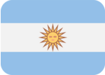 | Argentina | 3,528 | 19,656,998 | 2,046 | 4.21e+32 |
| IE |  | Ireland | 5,202 | 18,104,887 | 3,660 | 8.65e+31 |
| CO |  | Colombia | 2,337 | 17,972,129 | 1,529 | 3.43e+31 |
| TR |  | Türkiye | 3,587 | 17,385,930 | 2,498 | 3.68e+32 |
| VN |  | Vietnam | 2,273 | 16,764,338 | 1,604 | 3.47e+31 |
| NO |  | Norway | 3,214 | 16,384,415 | 1,144 | 1.83e+32 |
| FI |  | Finland | 3,654 | 14,957,749 | 43,061 | 1.19e+32 |
| BE |  | Belgium | 5,833 | 14,674,187 | 1,658 | 1.33e+32 |
| DK |  | Denmark | 3,949 | 12,672,073 | 1,133 | 1.65e+32 |
| MA |  | Morocco | 518 | 12,307,634 | 199 | 2.15e+31 |
| SA |  | Saudi Arabia | 1,766 | 11,927,869 | 820 | 5.01e+31 |
| AT |  | Austria | 4,646 | 11,406,184 | 2,292 | 1.93e+32 |
| IR |  | Islamic Republic of Iran | 2,068 | 10,959,721 | 707 | 3.20e+32 |
| CL |  | Chile | 2,002 | 10,513,788 | 7,625 | 2.35e+31 |
| TH |  | Thailand | 2,099 | 10,080,982 | 2,201 | 9.75e+30 |
| UA |  | Ukraine | 5,397 | 9,425,297 | 2,471 | 2.17e+32 |
| IL |  | Israel | 2,510 | 8,906,396 | 1,748 | 8.07e+31 |
| CZ |  | Czechia | 3,775 | 8,760,019 | 2,001 | 2.45e+32 |
| MY |  | Malaysia | 2,631 | 8,021,972 | 1,275 | 1.51e+31 |
| TN |  | Tunisia | 225 | 7,882,390 | 105 | 2.06e+30 |
| VE |  | Venezuela | 1,001 | 7,714,087 | 632 | 4.06e+31 |
| RO |  | Romania | 4,119 | 7,493,690 | 1,282 | 9.89e+31 |
| NZ |  | New Zealand | 2,355 | 7,384,677 | 1,578 | 2.42e+31 |
| PT |  | Portugal | 2,074 | 6,903,382 | 1,138 | 5.53e+31 |
| PH |  | Philippines | 2,246 | 6,751,043 | 1,142 | 1.82e+31 |
| AE |  | United Arab Emirates | 3,990 | 6,553,480 | 2,485 | 3.07e+32 |
| KE |  | Kenya | 928 | 6,398,763 | 393 | 1.24e+31 |
| HU |  | Hungary | 1,842 | 5,969,171 | 1,075 | 5.96e+31 |
| GR |  | Greece | 1,532 | 5,947,474 | 990 | 4.40e+31 |
| PK |  | Pakistan | 1,436 | 5,937,899 | 606 | 1.61e+31 |
| DZ |  | Algeria | 225 | 4,781,784 | 182 | 7.14e+29 |
| BG |  | Bulgaria | 2,370 | 4,306,730 | 880 | 9.50e+31 |
| PE |  | Peru | 1,132 | 3,665,181 | 664 | 1.75e+31 |
| KZ | 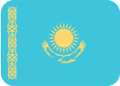 | Kazakhstan | 1,359 | 3,553,102 | 1,012 | 4.45e+31 |
| NG |  | Nigeria | 1,171 | 3,281,460 | 504 | 1.13e+31 |
| SC |  | Seychelles | 2,791 | 3,185,193 | 2,136 | 3.40e+32 |
| LT |  | Lithuania | 1,512 | 3,068,349 | 3,751 | 1.45e+32 |
| EC |  | Ecuador | 798 | 2,894,607 | 550 | 2.03e+31 |
| SK |  | Slovakia | 1,187 | 2,797,736 | 738 | 5.35e+31 |
| SI |  | Slovenia | 1,078 | 2,649,615 | 463 | 3.94e+31 |
| UY |  | Uruguay | 290 | 2,560,069 | 136 | 3.18e+30 |
| MU |  | Mauritius | 389 | 2,473,247 | 252 | 1.59e+30 |
| HR |  | Croatia | 849 | 2,472,208 | 313 | 2.89e+31 |
| CR |  | Costa Rica | 607 | 2,376,182 | 337 | 7.87e+30 |
| RS |  | Serbia | 1,020 | 2,337,243 | 374 | 3.42e+31 |
| GH |  | Ghana | 365 | 2,221,047 | 217 | 2.27e+31 |
| BD |  | Bangladesh | 2,864 | 2,172,939 | 1,954 | 5.83e+31 |
| LV |  | Latvia | 1,257 | 2,143,082 | 545 | 2.71e+31 |
| DO |  | Dominican Republic | 666 | 2,075,102 | 410 | 1.62e+31 |
| KW |  | Kuwait | 473 | 1,934,378 | 127 | 1.60e+31 |
| SD |  | Sudan | 129 | 1,899,846 | 78 | 1.19e+30 |
| BY |  | Belarus | 439 | 1,892,757 | 336 | 1.28e+31 |
| PA |  | Panama | 594 | 1,791,345 | 383 | 8.89e+30 |
| CI |  | Cote D'Ivoire | 354 | 1,713,844 | 115 | 3.50e+30 |
| ZM |  | Zambia | 176 | 1,659,158 | 96 | 7.93e+29 |
| EE |  | Estonia | 1,137 | 1,646,032 | 607 | 5.90e+31 |
| UG |  | Uganda | 252 | 1,465,166 | 123 | 2.22e+30 |
| LU |  | Luxembourg | 1,556 | 1,446,697 | 395 | 4.02e+31 |
| SY |  | Syrian Arab Republic | 318 | 1,319,349 | 84 | 1.62e+31 |
| QA |  | Qatar | 497 | 1,318,386 | 326 | 8.43e+30 |
| AO |  | Angola | 423 | 1,309,457 | 169 | 3.25e+30 |
| GE |  | Georgia | 484 | 1,302,352 | 263 | 3.68e+31 |
| MD |  | Moldova | 814 | 1,301,757 | 1,954 | 1.24e+32 |
| PY |  | Paraguay | 480 | 1,283,376 | 203 | 7.53e+30 |
| CY |  | Cyprus | 818 | 1,233,027 | 619 | 2.08e+32 |
| PR |  | Puerto Rico | 766 | 1,231,738 | 241 | 4.13e+30 |
| BO |  | Bolivia | 422 | 1,220,412 | 175 | 2.93e+30 |
| TZ |  | United Republic of Tanzania | 346 | 1,160,630 | 187 | 4.76e+30 |
| OM |  | Oman | 341 | 1,121,548 | 400 | 1.02e+31 |
| IS |  | Iceland | 388 | 941,358 | 441 | 2.66e+31 |
| BH |  | Bahrain | 265 | 923,142 | 191 | 7.32e+30 |
| PS |  | State of Palestine | 313 | 856,140 | 151 | 1.81e+31 |
| IQ |  | Iraq | 700 | 840,591 | 936 | 5.85e+31 |
| BA |  | Bosnia and Herzegovina | 314 | 825,869 | 143 | 1.35e+31 |
| XX |  | Unknown | 768 | 825,224 | 701 | 3.13e+30 |
| AZ |  | Azerbaijan | 428 | 791,802 | 253 | 3.37e+31 |
| SV | 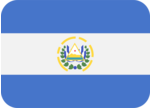 | El Salvador | 290 | 713,201 | 154 | 3.49e+30 |
| MK |  | North Macedonia | 283 | 709,933 | 129 | 1.89e+31 |
| GT | 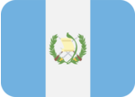 | Guatemala | 522 | 706,223 | 229 | 5.71e+30 |
| MT |  | Malta | 306 | 679,090 | 111 | 8.18e+30 |
| RE |  | Reunion | 225 | 673,969 | 81 | 2.15e+30 |
| JO |  | Jordan | 436 | 665,070 | 166 | 2.04e+31 |
| AM |  | Armenia | 352 | 608,856 | 422 | 2.32e+31 |
| CM |  | Cameroon | 185 | 607,274 | 104 | 1.26e+30 |
| NP |  | Nepal | 471 | 600,987 | 281 | 6.42e+30 |
| LK |  | Sri Lanka | 262 | 591,355 | 202 | 1.27e+30 |
| LB |  | Lebanon | 397 | 590,940 | 225 | 5.35e+31 |
| MG |  | Madagascar | 105 | 590,319 | 86 | 4.02e+29 |
| MW |  | Malawi | 126 | 561,876 | 96 | 2.28e+31 |
| TT |  | Trinidad and Tobago | 175 | 553,793 | 109 | 2.54e+30 |
| KH |  | Cambodia | 533 | 499,177 | 212 | 4.91e+30 |
| HN |  | Honduras | 375 | 496,515 | 230 | 6.66e+30 |
| LY |  | Libya | 157 | 488,717 | 76 | 1.27e+30 |
| MZ |  | Mozambique | 180 | 477,842 | 90 | 1.19e+30 |
| NA |  | Namibia | 150 | 466,721 | 73 | 5.53e+29 |
| NI | 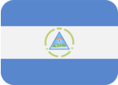 | Nicaragua | 197 | 446,693 | 94 | 1.59e+30 |
| VG |  | Virgin Islands, British | 251 | 431,196 | 331 | 1.60e+31 |
| SN |  | Senegal | 139 | 419,084 | 96 | 4.77e+29 |
| UZ |  | Uzbekistan | 561 | 417,915 | 221 | 2.12e+31 |
| BF |  | Burkina Faso | 143 | 415,084 | 105 | 1.67e+30 |
| GA |  | Gabon | 86 | 388,832 | 62 | 5.55e+29 |
| MO |  | Macau | 125 | 379,691 | 627 | 7.14e+29 |
| ET |  | Ethiopia | 116 | 375,145 | 82 | 2.06e+31 |
| TG |  | Togo | 87 | 359,137 | 58 | 4.76e+29 |
| AL |  | Albania | 408 | 352,060 | 1,071 | 4.70e+31 |
| RW | 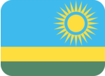 | Rwanda | 117 | 321,327 | 80 | 2.12e+31 |
| KG |  | Kyrgyzstan | 254 | 304,279 | 254 | 1.02e+31 |
| JM |  | Jamaica | 246 | 283,455 | 117 | 2.07e+31 |
| MM |  | Myanmar | 461 | 282,555 | 319 | 6.10e+30 |
| GM |  | Gambia | 89 | 281,362 | 69 | 7.14e+29 |
| GP |  | Guadeloupe | 239 | 276,966 | 78 | 8.81e+29 |
| CU |  | Cuba | 102 | 261,095 | 83 | 4.81e+29 |
| MQ |  | Martinique | 196 | 245,619 | 58 | 2.15e+30 |
| ZW |  | Zimbabwe | 212 | 244,269 | 122 | 1.27e+30 |
| GU |  | Guam | 162 | 241,233 | 101 | 6.35e+29 |
| YE |  | Yemen | 141 | 241,135 | 90 | 3.80e+30 |
| CD |  | The Democratic Republic of the Congo | 250 | 230,057 | 137 | 2.78e+30 |
| BN |  | Brunei | 119 | 222,146 | 73 | 4.76e+29 |
| ME |  | Montenegro | 150 | 199,289 | 96 | 7.92e+30 |
| CW |  | Curaçao | 119 | 194,129 | 85 | 2.85e+30 |
| MN |  | Mongolia | 259 | 189,157 | 235 | 2.46e+30 |
| AF |  | Afghanistan | 234 | 186,603 | 488 | 2.07e+30 |
| BW |  | Botswana | 150 | 174,615 | 82 | 1.35e+30 |
| VI |  | Virgin Islands, U.S. | 137 | 171,941 | 129 | 5.56e+29 |
| JE |  | Jersey | 142 | 171,559 | 77 | 4.75e+30 |
| HT |  | Haiti | 103 | 161,991 | 102 | 3.97e+29 |
| BS |  | Bahamas | 163 | 161,003 | 115 | 2.44e+29 |
| XK |  | Kosovo | 50 | 160,337 | 58 | 1.98e+30 |
| BJ |  | Benin | 111 | 159,454 | 74 | 9.51e+29 |
| FJ |  | Fiji | 129 | 150,218 | 76 | 7.14e+29 |
| CG |  | Congo | 97 | 149,172 | 74 | 6.35e+29 |
| NC |  | New Caledonia | 92 | 145,084 | 89 | 8.72e+29 |
| IM |  | Isle of Man | 211 | 139,605 | 136 | 7.92e+30 |
| AG |  | Antigua and Barbuda | 129 | 133,996 | 135 | 8.81e+29 |
| BB |  | Barbados | 196 | 132,906 | 82 | 1.34e+30 |
| LS |  | Lesotho | 82 | 129,176 | 64 | 4.76e+29 |
| BM |  | Bermuda | 347 | 124,675 | 85 | 8.72e+29 |
| BZ |  | Belize | 161 | 124,313 | 140 | 3.80e+30 |
| KY |  | Cayman Islands | 162 | 121,722 | 82 | 3.23e+29 |
| GF |  | French Guiana | 116 | 120,849 | 57 | 5.14e+29 |
| AW |  | Aruba | 85 | 113,589 | 74 | 1.59e+29 |
| LI |  | Liechtenstein | 380 | 110,015 | 111 | 8.40e+30 |
| GI |  | Gibraltar | 160 | 103,869 | 67 | 3.09e+30 |
| LA |  | Lao People's Democratic Republic | 169 | 102,973 | 102 | 1.43e+30 |
| MV |  | Maldives | 139 | 99,536 | 97 | 3.18e+29 |
| TJ |  | Tajikistan | 154 | 98,076 | 103 | 1.18e+31 |
| ML |  | Mali | 93 | 97,490 | 60 | 3.97e+29 |
| SL |  | Sierra Leone | 98 | 92,611 | 71 | 4.76e+29 |
| SR |  | Suriname | 70 | 89,100 | 72 | 3.18e+29 |
| YT |  | Mayotte | 76 | 81,537 | 52 | 8.52e+28 |
| PG |  | Papua New Guinea | 249 | 81,165 | 112 | 1.11e+30 |
| MC |  | Monaco | 249 | 79,376 | 79 | 2.69e+30 |
| PF |  | French Polynesia | 108 | 78,595 | 123 | 3.97e+29 |
| GY |  | Guyana | 73 | 74,992 | 72 | 5.56e+29 |
| AD |  | Andorra | 244 | 72,602 | 134 | 4.82e+29 |
| GG |  | Guernsey | 112 | 66,813 | 69 | 3.49e+30 |
| CV |  | Cabo Verde | 103 | 60,882 | 69 | 2.39e+29 |
| DJ |  | Djibouti | 74 | 60,167 | 75 | 1.60e+29 |
| SZ |  | Eswatini | 80 | 59,857 | 69 | 5.55e+29 |
| MR | 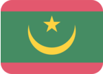 | Mauritania | 82 | 58,327 | 64 | 4.76e+29 |
| BT |  | Bhutan | 141 | 57,338 | 114 | 1.11e+30 |
| NE |  | Niger | 78 | 56,523 | 62 | 3.98e+29 |
| SO |  | Somalia | 84 | 56,055 | 106 | 8.73e+29 |
| FO |  | Faroe Islands | 58 | 45,721 | 54 | 1.98e+30 |
| LR |  | Liberia | 99 | 45,565 | 73 | 4.76e+29 |
| AX |  | Aland Islands | 64 | 44,942 | 105 | 8.72e+29 |
| GN |  | Guinea | 89 | 44,374 | 65 | 8.73e+29 |
| BI | 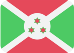 | Burundi | 75 | 43,720 | 57 | 3.97e+29 |
| KN |  | Saint Kitts and Nevis | 90 | 41,867 | 70 | 6.41e+29 |
| SM |  | San Marino | 106 | 40,144 | 64 | 3.57e+30 |
| LC |  | Saint Lucia | 108 | 39,647 | 69 | 1.42e+30 |
| SX |  | Sint Maarten | 54 | 38,072 | 56 | 4.76e+29 |
| GL |  | Greenland | 119 | 36,758 | 138 | 7.93e+29 |
| AS |  | American Samoa | 83 | 33,955 | 354 | 1.59e+29 |
| SS |  | South Sudan | 107 | 33,552 | 69 | 5.56e+29 |
| GD |  | Grenada | 117 | 33,321 | 74 | 1.44e+30 |
| MH |  | Marshall Islands | 63 | 31,408 | 57 | 1.98e+30 |
| TD |  | Chad | 100 | 31,021 | 65 | 2.39e+29 |
| TL |  | Timor-Leste | 102 | 30,242 | 68 | 7.14e+29 |
| BQ |  | Caribbean Netherlands | 52 | 29,439 | 62 | 1.03e+30 |
| TM |  | Turkmenistan | 85 | 28,370 | 67 | 1.27e+30 |
| VC |  | Saint Vincent and the Grenadines | 88 | 25,165 | 54 | 1.27e+30 |
| WS |  | Samoa | 80 | 23,536 | 61 | 3.18e+29 |
| GQ |  | Equatorial Guinea | 71 | 23,434 | 51 | 1.59e+29 |
| DM | 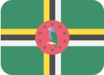 | Dominica | 96 | 21,295 | 68 | 7.98e+29 |
| MP |  | Northern Mariana Islands | 51 | 19,877 | 57 | 7.99e+28 |
| SB |  | Solomon Islands | 67 | 17,794 | 55 | 3.18e+29 |
| VU |  | Vanuatu | 76 | 17,683 | 215 | 8.75e+29 |
| TC |  | Turks and Caicos Islands | 65 | 17,097 | 61 | 2.05e+28 |
| AI |  | Anguilla | 72 | 16,765 | 74 | 5.96e+27 |
| MF |  | Saint Martin | 84 | 15,822 | 65 | 8.55e+28 |
| VA |  | Holy See (Vatican City State) | 41 | 15,228 | 71 | 1.90e+30 |
| ST |  | Sao Tome and Principe | 59 | 14,971 | 58 | 7.99e+28 |
| TO |  | Tonga | 63 | 14,541 | 57 | 3.18e+29 |
| NR |  | Nauru | 50 | 12,987 | 62 | 1.59e+29 |
| FM |  | Federated States of Micronesia | 77 | 12,169 | 75 | 1.59e+29 |
| KM |  | Comoros | 61 | 11,703 | 51 | 1.59e+29 |
| TV |  | Tuvalu | 55 | 11,281 | 51 | 1.59e+29 |
| PW | 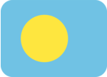 | Palau | 60 | 11,240 | 52 | 1.59e+29 |
| GW |  | Guinea-Bissau | 62 | 9,949 | 66 | 1.59e+29 |
| CK |  | Cook Islands | 49 | 9,908 | 66 | 1.59e+29 |
| CF |  | Central African Republic | 62 | 9,857 | 57 | 1.01e+27 |
| KI | 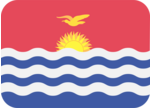 | Kiribati | 92 | 8,177 | 96 | 2.38e+29 |
| ER |  | Eritrea | 66 | 7,388 | 56 | 6.99e+26 |
| PM |  | Saint Pierre and Miquelon | 62 | 7,110 | 60 | 7.99e+28 |
| FK |  | Falkland Islands (Malvinas) | 42 | 5,503 | 52 | 7.01e+26 |
| TK |  | Tokelau | 36 | 4,761 | 70 | 8.00e+28 |
| WF |  | Wallis and Futuna | 35 | 4,209 | 57 | 7.99e+28 |
| IO |  | British Indian Ocean Territory | 40 | 3,689 | 62 | 7.99e+28 |
| KP |  | Democratic People's Republic of Korea | 11 | 2,568 | 534 | 2.94e+26 |
| MS |  | Montserrat | 39 | 2,558 | 52 | 6.95e+26 |
| BL |  | Saint Barthelemy | 44 | 2,265 | 63 | 1.09e+28 |
| AQ |  | Antarctica | 49 | 1,779 | 751 | 8.02e+28 |
| SH |  | Saint Helena | 16 | 1,038 | 18 | 6.40e+26 |
| NF |  | Norfolk Island | 49 | 913 | 58 | 3.91e+26 |
| NU |  | Niue | 43 | 912 | 53 | 7.99e+28 |
| UM |  | United States Minor Outlying Islands | 20 | 546 | 64 | 6.62e+26 |
| SJ |  | Svalbard and Jan Mayen | 15 | 527 | 28 | 6.64e+26 |
| PN |  | Pitcairn | 14 | 526 | 22 | 6.43e+26 |
| GS |  | South Georgia and the South Sandwich Islands | 13 | 525 | 17 | 6.40e+26 |
| HM |  | Heard Island and McDonald Islands | 12 | 524 | 24 | 6.45e+26 |
| BV |  | Bouvet Island | 14 | 270 | 24 | 3.35e+26 |
| EH |  | Western Sahara | 15 | 31 | 28 | 3.37e+26 |
| CX |  | Christmas Island | 18 | 24 | 54 | 3.50e+26 |
| CC |  | Cocos (Keeling) Islands | 18 | 23 | 21 | 3.33e+26 |
| TF |  | French Southern Territories | 11 | 12 | 11 | 1.99e+25 |

## Credit

- [P3TERX/GeoLite.mmdb](https://github.com/P3TERX/GeoLite.mmdb)

## License

- Database and Contents Copyright (c) [MaxMind](https://www.maxmind.com/), Inc.
- [GeoLite2 End User License Agreement](https://www.maxmind.com/en/geolite2/eula)