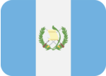
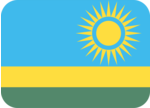
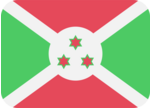

# ip-country-ranking

Country-ranked global IP statistics, based on data from [MaxMind's GeoLite2](https://dev.maxmind.com/geoip/geoip2/geolite2/)

## IP Count (Sorted by IPv4 Count)

Country names follow the naming convention from [ppy/osu](https://github.com/ppy/osu), and flags are sourced from [Twemoji](https://github.com/twitter/twemoji) 14.0.2 assets

| ISO | Flag | Country | IPv4 Blocks | IPv4 Count | IPv6 Blocks | IPv6 Count |
| :---: | :---: | --- | :---: | :---: | :---: | :---: |
| US |  | United States | 129,660 | 1,511,616,055 | 130,936 | 1.18e+34 |
| CN |  | China | 7,916 | 345,271,642 | 11,501 | 5.43e+33 |
| JP |  | Japan | 12,517 | 199,985,065 | 5,404 | 8.16e+32 |
| DE |  | Germany | 30,694 | 135,694,173 | 43,341 | 1.97e+33 |
| GB |  | United Kingdom | 36,639 | 129,428,364 | 14,372 | 1.71e+33 |
| KR |  | South Korea | 4,019 | 116,271,124 | 1,597 | 4.19e+32 |
| BR |  | Brazil | 11,509 | 85,138,174 | 12,591 | 6.76e+32 |
| FR |  | France | 33,702 | 83,562,557 | 6,815 | 1.22e+33 |
| CA |  | Canada | 17,735 | 72,616,241 | 9,889 | 1.18e+32 |
| IT |  | Italy | 10,083 | 57,286,263 | 3,631 | 8.59e+32 |
| NL |  | Netherlands | 19,146 | 54,757,128 | 59,110 | 8.58e+32 |
| AU |  | Australia | 11,807 | 53,005,030 | 6,270 | 7.89e+32 |
| IN |  | India | 13,686 | 48,923,461 | 7,779 | 5.42e+32 |
| RU |  | Russian Federation | 13,419 | 45,788,351 | 12,179 | 8.74e+32 |
| TW |  | Taiwan | 2,509 | 37,193,793 | 2,470 | 2.07e+32 |
| ES |  | Spain | 11,739 | 35,524,944 | 3,160 | 4.56e+32 |
| SE |  | Sweden | 10,330 | 32,219,132 | 4,116 | 5.56e+32 |
| MX |  | Mexico | 4,410 | 30,866,277 | 1,930 | 6.32e+31 |
| ZA |  | South Africa | 3,974 | 29,085,137 | 1,844 | 4.27e+32 |
| SG |  | Singapore | 9,869 | 28,246,474 | 4,793 | 2.74e+33 |
| CH |  | Switzerland | 6,618 | 24,813,073 | 5,316 | 3.30e+32 |
| EG |  | Egypt | 786 | 24,216,068 | 209 | 3.27e+32 |
| HK |  | Hong Kong | 11,285 | 22,861,056 | 4,737 | 1.81e+32 |
| PL |  | Poland | 8,513 | 21,112,404 | 3,391 | 5.05e+32 |
| ID |  | Indonesia | 6,834 | 20,234,988 | 4,344 | 6.76e+31 |
| AR |  | Argentina | 3,631 | 19,729,301 | 2,058 | 4.22e+32 |
| IE |  | Ireland | 5,195 | 18,127,843 | 4,392 | 8.78e+31 |
| CO |  | Colombia | 2,333 | 17,970,585 | 1,537 | 3.45e+31 |
| TR |  | Türkiye | 3,594 | 17,376,913 | 1,864 | 3.68e+32 |
| VN |  | Vietnam | 2,267 | 16,760,119 | 1,607 | 3.48e+31 |
| NO |  | Norway | 3,270 | 16,309,942 | 1,179 | 1.81e+32 |
| FI |  | Finland | 3,736 | 15,000,704 | 43,484 | 1.18e+32 |
| BE |  | Belgium | 5,792 | 14,653,027 | 1,573 | 1.34e+32 |
| DK |  | Denmark | 3,978 | 12,653,189 | 1,164 | 1.66e+32 |
| SA |  | Saudi Arabia | 1,811 | 12,493,339 | 825 | 5.01e+31 |
| MA |  | Morocco | 519 | 12,305,595 | 204 | 2.15e+31 |
| AT |  | Austria | 4,627 | 11,417,288 | 2,460 | 1.97e+32 |
| IR |  | Islamic Republic of Iran | 2,079 | 10,963,560 | 690 | 3.23e+32 |
| CL |  | Chile | 2,000 | 10,511,868 | 7,623 | 2.36e+31 |
| TH |  | Thailand | 2,107 | 10,081,678 | 1,517 | 9.71e+30 |
| UA |  | Ukraine | 5,436 | 9,444,133 | 2,482 | 2.11e+32 |
| IL |  | Israel | 2,520 | 8,901,041 | 1,757 | 8.08e+31 |
| CZ |  | Czechia | 3,785 | 8,748,556 | 2,035 | 2.45e+32 |
| MY |  | Malaysia | 2,682 | 8,071,511 | 1,360 | 1.51e+31 |
| TN |  | Tunisia | 231 | 7,882,399 | 110 | 2.06e+30 |
| VE |  | Venezuela | 1,021 | 7,749,160 | 635 | 4.08e+31 |
| RO |  | Romania | 4,142 | 7,488,031 | 1,233 | 9.89e+31 |
| NZ |  | New Zealand | 2,335 | 7,380,186 | 1,585 | 2.42e+31 |
| PT |  | Portugal | 2,100 | 6,898,431 | 1,146 | 5.59e+31 |
| PH |  | Philippines | 2,254 | 6,754,504 | 1,155 | 1.84e+31 |
| AE |  | United Arab Emirates | 3,974 | 6,542,173 | 2,505 | 3.06e+32 |
| KE |  | Kenya | 922 | 6,389,043 | 398 | 1.25e+31 |
| HU |  | Hungary | 1,848 | 5,960,185 | 1,044 | 5.96e+31 |
| GR |  | Greece | 1,545 | 5,937,630 | 998 | 4.40e+31 |
| PK |  | Pakistan | 1,443 | 5,931,751 | 604 | 1.61e+31 |
| DZ |  | Algeria | 224 | 4,779,360 | 187 | 7.14e+29 |
| BG |  | Bulgaria | 2,381 | 4,302,613 | 882 | 9.43e+31 |
| PE |  | Peru | 1,149 | 3,705,804 | 684 | 1.75e+31 |
| KZ |  | Kazakhstan | 1,361 | 3,557,088 | 1,016 | 4.45e+31 |
| SC |  | Seychelles | 2,514 | 3,545,902 | 2,106 | 3.40e+32 |
| NG |  | Nigeria | 1,169 | 3,275,710 | 504 | 1.12e+31 |
| LT |  | Lithuania | 1,518 | 3,029,213 | 2,938 | 1.44e+32 |
| EC |  | Ecuador | 791 | 2,894,287 | 558 | 2.04e+31 |
| SK |  | Slovakia | 1,195 | 2,792,805 | 759 | 5.34e+31 |
| SI |  | Slovenia | 1,080 | 2,652,378 | 475 | 3.94e+31 |
| UY |  | Uruguay | 288 | 2,492,935 | 138 | 3.18e+30 |
| MU |  | Mauritius | 394 | 2,486,573 | 254 | 1.59e+30 |
| HR |  | Croatia | 852 | 2,465,831 | 287 | 2.89e+31 |
| CR |  | Costa Rica | 604 | 2,373,758 | 341 | 7.87e+30 |
| RS |  | Serbia | 1,021 | 2,331,107 | 377 | 3.35e+31 |
| GH |  | Ghana | 365 | 2,219,512 | 222 | 2.27e+31 |
| BD |  | Bangladesh | 2,939 | 2,188,304 | 2,126 | 5.84e+31 |
| LV |  | Latvia | 1,255 | 2,126,711 | 459 | 2.71e+31 |
| DO |  | Dominican Republic | 677 | 2,081,181 | 411 | 1.62e+31 |
| KW |  | Kuwait | 468 | 1,930,934 | 670 | 1.60e+31 |
| SD |  | Sudan | 125 | 1,898,060 | 80 | 1.19e+30 |
| BY |  | Belarus | 466 | 1,887,352 | 336 | 1.28e+31 |
| PA |  | Panama | 601 | 1,794,424 | 393 | 9.61e+30 |
| CI |  | Cote D'Ivoire | 354 | 1,712,572 | 120 | 3.50e+30 |
| ZM |  | Zambia | 172 | 1,657,372 | 99 | 7.94e+29 |
| EE |  | Estonia | 1,133 | 1,618,916 | 647 | 5.90e+31 |
| UG |  | Uganda | 247 | 1,465,187 | 124 | 2.14e+30 |
| LU |  | Luxembourg | 1,543 | 1,437,652 | 393 | 3.96e+31 |
| SY |  | Syrian Arab Republic | 312 | 1,317,557 | 82 | 1.62e+31 |
| QA |  | Qatar | 491 | 1,317,373 | 330 | 8.43e+30 |
| AO |  | Angola | 421 | 1,310,102 | 171 | 3.25e+30 |
| GE |  | Georgia | 481 | 1,300,182 | 266 | 3.68e+31 |
| MD |  | Moldova | 799 | 1,289,731 | 1,957 | 1.24e+32 |
| PY |  | Paraguay | 482 | 1,284,166 | 209 | 7.53e+30 |
| PR |  | Puerto Rico | 797 | 1,280,670 | 242 | 4.13e+30 |
| CY |  | Cyprus | 856 | 1,231,750 | 614 | 2.08e+32 |
| BO |  | Bolivia | 407 | 1,217,977 | 177 | 2.93e+30 |
| TZ |  | United Republic of Tanzania | 341 | 1,137,596 | 188 | 4.68e+30 |
| OM |  | Oman | 346 | 1,120,986 | 401 | 1.02e+31 |
| IS |  | Iceland | 393 | 940,402 | 447 | 2.66e+31 |
| BH |  | Bahrain | 263 | 920,335 | 192 | 7.32e+30 |
| PS |  | State of Palestine | 310 | 856,399 | 153 | 1.81e+31 |
| IQ |  | Iraq | 703 | 839,114 | 938 | 5.85e+31 |
| XX |  | Unknown | 770 | 830,055 | 735 | 3.13e+30 |
| BA |  | Bosnia and Herzegovina | 318 | 827,638 | 145 | 1.35e+31 |
| AZ |  | Azerbaijan | 424 | 790,399 | 253 | 3.42e+31 |
| SV |  | El Salvador | 293 | 714,234 | 159 | 3.49e+30 |
| MK |  | North Macedonia | 291 | 710,966 | 131 | 1.89e+31 |
| GT |  | Guatemala | 532 | 709,048 | 239 | 5.71e+30 |
| MT |  | Malta | 313 | 679,100 | 116 | 8.18e+30 |
| RE |  | Reunion | 223 | 671,153 | 91 | 2.15e+30 |
| JO |  | Jordan | 451 | 666,112 | 171 | 2.04e+31 |
| CM |  | Cameroon | 189 | 603,697 | 109 | 1.26e+30 |
| AM |  | Armenia | 377 | 602,359 | 425 | 2.45e+31 |
| NP |  | Nepal | 467 | 600,480 | 282 | 6.42e+30 |
| LK |  | Sri Lanka | 266 | 591,617 | 956 | 1.27e+30 |
| MG |  | Madagascar | 101 | 588,533 | 88 | 4.02e+29 |
| LB |  | Lebanon | 396 | 588,129 | 225 | 5.28e+31 |
| MW |  | Malawi | 122 | 560,090 | 98 | 2.28e+31 |
| TT |  | Trinidad and Tobago | 164 | 550,218 | 116 | 2.54e+30 |
| KH |  | Cambodia | 534 | 499,183 | 215 | 4.91e+30 |
| HN |  | Honduras | 391 | 496,011 | 237 | 6.66e+30 |
| LY |  | Libya | 152 | 486,675 | 78 | 1.27e+30 |
| MZ |  | Mozambique | 176 | 476,056 | 92 | 1.19e+30 |
| NA |  | Namibia | 143 | 463,399 | 77 | 5.53e+29 |
| NI |  | Nicaragua | 196 | 444,655 | 99 | 1.59e+30 |
| UZ |  | Uzbekistan | 561 | 417,412 | 227 | 2.12e+31 |
| SN |  | Senegal | 138 | 416,533 | 100 | 4.77e+29 |
| BF |  | Burkina Faso | 142 | 413,556 | 110 | 1.67e+30 |
| GA |  | Gabon | 85 | 386,794 | 67 | 5.55e+29 |
| MO |  | Macau | 124 | 379,179 | 627 | 7.14e+29 |
| ET |  | Ethiopia | 115 | 374,385 | 87 | 2.06e+31 |
| TG |  | Togo | 86 | 357,354 | 63 | 4.76e+29 |
| AL |  | Albania | 394 | 347,985 | 1,057 | 4.70e+31 |
| RW |  | Rwanda | 113 | 318,773 | 82 | 2.12e+31 |
| KG |  | Kyrgyzstan | 257 | 300,447 | 178 | 1.02e+31 |
| JM |  | Jamaica | 245 | 281,417 | 123 | 2.07e+31 |
| MM |  | Myanmar | 456 | 280,513 | 321 | 6.10e+30 |
| GM |  | Gambia | 86 | 278,299 | 75 | 7.14e+29 |
| GP |  | Guadeloupe | 232 | 273,930 | 83 | 8.80e+29 |
| ZW |  | Zimbabwe | 241 | 263,727 | 124 | 1.27e+30 |
| CU |  | Cuba | 91 | 258,534 | 82 | 4.81e+29 |
| MQ |  | Martinique | 190 | 247,158 | 61 | 2.15e+30 |
| VG |  | Virgin Islands, British | 314 | 242,686 | 333 | 1.60e+31 |
| GU |  | Guam | 166 | 241,457 | 98 | 6.35e+29 |
| YE |  | Yemen | 137 | 239,349 | 92 | 3.80e+30 |
| BN |  | Brunei | 122 | 222,279 | 75 | 4.76e+29 |
| CD |  | The Democratic Republic of the Congo | 241 | 220,846 | 139 | 2.78e+30 |
| ME |  | Montenegro | 148 | 197,250 | 101 | 7.92e+30 |
| CW |  | Curaçao | 123 | 194,643 | 87 | 2.85e+30 |
| MN |  | Mongolia | 254 | 187,115 | 237 | 2.46e+30 |
| AF |  | Afghanistan | 229 | 184,816 | 489 | 2.07e+30 |
| BW |  | Botswana | 152 | 174,620 | 84 | 1.35e+30 |
| VI |  | Virgin Islands, U.S. | 138 | 172,069 | 122 | 5.56e+29 |
| JE |  | Jersey | 142 | 170,090 | 80 | 4.75e+30 |
| XK |  | Kosovo | 51 | 161,616 | 58 | 1.98e+30 |
| HT |  | Haiti | 102 | 160,208 | 107 | 3.97e+29 |
| BS |  | Bahamas | 163 | 159,603 | 121 | 2.44e+29 |
| BJ |  | Benin | 109 | 157,670 | 79 | 9.51e+29 |
| FJ |  | Fiji | 128 | 148,435 | 81 | 7.14e+29 |
| CG |  | Congo | 93 | 147,641 | 76 | 6.35e+29 |
| NC |  | New Caledonia | 95 | 145,087 | 92 | 8.72e+29 |
| IM |  | Isle of Man | 213 | 138,584 | 137 | 7.92e+30 |
| AG |  | Antigua and Barbuda | 130 | 133,748 | 140 | 8.81e+29 |
| BB |  | Barbados | 193 | 130,482 | 87 | 1.34e+30 |
| LS |  | Lesotho | 77 | 127,134 | 66 | 4.76e+29 |
| BM |  | Bermuda | 350 | 124,805 | 88 | 8.72e+29 |
| BZ |  | Belize | 158 | 122,273 | 145 | 3.80e+30 |
| KY |  | Cayman Islands | 157 | 122,110 | 84 | 3.23e+29 |
| GF |  | French Guiana | 121 | 120,337 | 57 | 5.14e+29 |
| AW |  | Aruba | 88 | 113,719 | 76 | 1.59e+29 |
| LI |  | Liechtenstein | 379 | 108,104 | 106 | 8.48e+30 |
| GI |  | Gibraltar | 166 | 103,360 | 69 | 3.09e+30 |
| LA |  | Lao People's Democratic Republic | 162 | 100,419 | 104 | 1.43e+30 |
| TJ |  | Tajikistan | 155 | 99,621 | 108 | 1.18e+31 |
| MV |  | Maldives | 135 | 97,750 | 95 | 3.18e+29 |
| ML |  | Mali | 89 | 95,704 | 62 | 3.97e+29 |
| SL |  | Sierra Leone | 98 | 91,084 | 76 | 4.76e+29 |
| SR |  | Suriname | 66 | 87,314 | 74 | 3.18e+29 |
| YT |  | Mayotte | 67 | 82,049 | 52 | 8.52e+28 |
| MC |  | Monaco | 255 | 79,527 | 83 | 2.69e+30 |
| PF |  | French Polynesia | 108 | 79,110 | 124 | 3.97e+29 |
| PG |  | Papua New Guinea | 239 | 77,075 | 114 | 1.11e+30 |
| GY |  | Guyana | 72 | 73,209 | 77 | 5.56e+29 |
| AD |  | Andorra | 247 | 70,823 | 138 | 4.82e+29 |
| GG |  | Guernsey | 114 | 68,544 | 71 | 3.49e+30 |
| CV |  | Cabo Verde | 102 | 59,354 | 74 | 2.39e+29 |
| MR |  | Mauritania | 89 | 58,592 | 69 | 4.76e+29 |
| DJ |  | Djibouti | 72 | 58,383 | 80 | 1.60e+29 |
| SZ |  | Eswatini | 76 | 58,071 | 72 | 6.35e+29 |
| BT |  | Bhutan | 137 | 55,807 | 115 | 1.11e+30 |
| NE |  | Niger | 71 | 54,737 | 64 | 3.98e+29 |
| SO |  | Somalia | 80 | 54,269 | 108 | 8.73e+29 |
| FO |  | Faroe Islands | 61 | 45,724 | 56 | 1.98e+30 |
| AX |  | Aland Islands | 66 | 44,944 | 107 | 8.72e+29 |
| LR |  | Liberia | 97 | 43,526 | 78 | 4.76e+29 |
| GN |  | Guinea | 88 | 42,591 | 70 | 8.73e+29 |
| BI |  | Burundi | 70 | 41,933 | 59 | 3.97e+29 |
| KN |  | Saint Kitts and Nevis | 96 | 40,085 | 75 | 6.41e+29 |
| LC |  | Saint Lucia | 108 | 38,120 | 74 | 1.42e+30 |
| SM |  | San Marino | 104 | 38,105 | 69 | 3.57e+30 |
| SX |  | Sint Maarten | 56 | 37,819 | 58 | 4.76e+29 |
| GL |  | Greenland | 119 | 36,758 | 133 | 7.93e+29 |
| AS |  | American Samoa | 85 | 33,957 | 356 | 1.59e+29 |
| MH |  | Marshall Islands | 59 | 31,934 | 58 | 1.98e+30 |
| SS |  | South Sudan | 103 | 31,766 | 70 | 5.56e+29 |
| GD |  | Grenada | 115 | 30,514 | 79 | 1.44e+30 |
| TL |  | Timor-Leste | 105 | 30,248 | 70 | 7.14e+29 |
| TD |  | Chad | 100 | 29,494 | 70 | 2.39e+29 |
| BQ |  | Caribbean Netherlands | 54 | 29,441 | 65 | 1.03e+30 |
| TM |  | Turkmenistan | 84 | 26,587 | 72 | 1.27e+30 |
| VC |  | Saint Vincent and the Grenadines | 87 | 23,382 | 59 | 1.27e+30 |
| WS |  | Samoa | 76 | 21,750 | 63 | 3.18e+29 |
| MP |  | Northern Mariana Islands | 50 | 21,413 | 56 | 7.99e+28 |
| GQ |  | Equatorial Guinea | 69 | 21,395 | 56 | 1.59e+29 |
| DM |  | Dominica | 95 | 20,023 | 73 | 7.98e+29 |
| MF |  | Saint Martin | 91 | 18,129 | 76 | 8.80e+28 |
| TC |  | Turks and Caicos Islands | 68 | 17,100 | 63 | 2.05e+28 |
| SB |  | Solomon Islands | 66 | 16,011 | 60 | 3.18e+29 |
| AI |  | Anguilla | 74 | 15,999 | 76 | 5.96e+27 |
| VU |  | Vanuatu | 76 | 15,964 | 195 | 8.75e+29 |
| VA |  | Holy See (Vatican City State) | 44 | 15,231 | 73 | 1.90e+30 |
| ST |  | Sao Tome and Principe | 58 | 13,188 | 63 | 7.99e+28 |
| TO |  | Tonga | 59 | 12,755 | 59 | 3.18e+29 |
| PW |  | Palau | 62 | 10,990 | 54 | 1.59e+29 |
| NR |  | Nauru | 48 | 10,948 | 67 | 1.59e+29 |
| KM |  | Comoros | 58 | 10,173 | 53 | 1.59e+29 |
| FM |  | Federated States of Micronesia | 75 | 10,130 | 80 | 1.59e+29 |
| CK |  | Cook Islands | 51 | 9,910 | 68 | 1.59e+29 |
| TV |  | Tuvalu | 54 | 9,498 | 56 | 1.59e+29 |
| CF |  | Central African Republic | 60 | 8,838 | 59 | 1.01e+27 |
| GW |  | Guinea-Bissau | 61 | 8,166 | 71 | 1.59e+29 |
| PM |  | Saint Pierre and Miquelon | 65 | 7,113 | 63 | 7.99e+28 |
| KI |  | Kiribati | 90 | 6,138 | 101 | 2.38e+29 |
| ER |  | Eritrea | 64 | 5,604 | 61 | 6.97e+26 |
| FK |  | Falkland Islands (Malvinas) | 45 | 5,506 | 54 | 6.99e+26 |
| TK |  | Tokelau | 39 | 4,764 | 73 | 8.00e+28 |
| WF |  | Wallis and Futuna | 38 | 4,212 | 59 | 7.99e+28 |
| IO |  | British Indian Ocean Territory | 43 | 3,692 | 65 | 7.99e+28 |
| BL |  | Saint Barthelemy | 47 | 3,291 | 67 | 1.09e+28 |
| MS |  | Montserrat | 42 | 2,561 | 54 | 6.93e+26 |
| KP |  | Democratic People's Republic of Korea | 8 | 1,800 | 534 | 2.94e+26 |
| AQ |  | Antarctica | 51 | 1,781 | 760 | 8.02e+28 |
| SH |  | Saint Helena | 19 | 1,041 | 21 | 6.40e+26 |
| NF |  | Norfolk Island | 52 | 916 | 61 | 3.91e+26 |
| NU |  | Niue | 46 | 915 | 55 | 7.99e+28 |
| UM |  | United States Minor Outlying Islands | 23 | 549 | 67 | 6.62e+26 |
| SJ |  | Svalbard and Jan Mayen | 18 | 530 | 31 | 6.64e+26 |
| PN |  | Pitcairn | 17 | 529 | 25 | 6.43e+26 |
| GS |  | South Georgia and the South Sandwich Islands | 13 | 525 | 17 | 6.40e+26 |
| HM |  | Heard Island and McDonald Islands | 12 | 524 | 24 | 6.45e+26 |
| BV |  | Bouvet Island | 13 | 269 | 24 | 3.35e+26 |
| EH |  | Western Sahara | 17 | 33 | 31 | 3.37e+26 |
| CX |  | Christmas Island | 20 | 26 | 57 | 3.50e+26 |
| CC |  | Cocos (Keeling) Islands | 20 | 25 | 24 | 3.33e+26 |
| TF |  | French Southern Territories | 11 | 12 | 11 | 1.99e+25 |

## Credit

- [P3TERX/GeoLite.mmdb](https://github.com/P3TERX/GeoLite.mmdb)

## License

- Database and Contents Copyright (c) [MaxMind](https://www.maxmind.com/), Inc.
- [GeoLite2 End User License Agreement](https://www.maxmind.com/en/geolite2/eula)