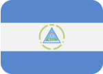
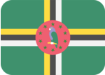

# ip-country-ranking

Country-ranked global IP statistics, based on data from [MaxMind's GeoLite2](https://dev.maxmind.com/geoip/geoip2/geolite2/)

## IP Count (Sorted by IPv4 Count)

Country names follow the naming convention from [ppy/osu](https://github.com/ppy/osu), and flags are sourced from [Twemoji](https://github.com/twitter/twemoji) 14.0.2 assets

| ISO | Flag | Country | IPv4 Blocks | IPv4 Count | IPv6 Blocks | IPv6 Count |
| :---: | :---: | --- | :---: | :---: | :---: | :---: |
| US |  | United States | 128,971 | 1,511,047,631 | 131,929 | 1.18e+34 |
| CN |  | China | 7,915 | 345,270,363 | 11,499 | 5.43e+33 |
| JP |  | Japan | 12,436 | 199,955,034 | 5,332 | 8.15e+32 |
| DE |  | Germany | 30,619 | 135,713,940 | 42,884 | 1.97e+33 |
| GB |  | United Kingdom | 36,546 | 129,218,769 | 14,267 | 1.71e+33 |
| KR |  | South Korea | 4,001 | 116,271,371 | 1,587 | 4.19e+32 |
| BR |  | Brazil | 11,484 | 85,404,690 | 12,595 | 6.76e+32 |
| FR |  | France | 33,651 | 83,531,142 | 6,761 | 1.22e+33 |
| CA |  | Canada | 17,665 | 72,589,535 | 9,749 | 1.18e+32 |
| IT |  | Italy | 10,034 | 57,285,460 | 3,591 | 8.59e+32 |
| NL |  | Netherlands | 19,102 | 54,675,724 | 59,102 | 8.55e+32 |
| AU |  | Australia | 11,846 | 52,989,696 | 6,272 | 7.90e+32 |
| IN |  | India | 13,680 | 48,919,175 | 7,762 | 5.42e+32 |
| RU |  | Russian Federation | 13,386 | 45,776,568 | 12,180 | 8.77e+32 |
| TW |  | Taiwan | 2,465 | 37,192,425 | 2,427 | 2.07e+32 |
| ES |  | Spain | 11,654 | 35,524,040 | 3,117 | 4.56e+32 |
| SE |  | Sweden | 10,326 | 32,261,212 | 4,101 | 5.56e+32 |
| MX |  | Mexico | 4,376 | 30,866,024 | 1,892 | 6.31e+31 |
| ZA |  | South Africa | 3,999 | 29,094,894 | 1,563 | 4.27e+32 |
| SG |  | Singapore | 9,821 | 28,233,612 | 4,778 | 2.74e+33 |
| CH |  | Switzerland | 6,593 | 24,811,269 | 5,344 | 3.29e+32 |
| EG |  | Egypt | 786 | 24,216,068 | 209 | 3.27e+32 |
| HK |  | Hong Kong | 11,302 | 22,945,298 | 4,736 | 1.81e+32 |
| PL |  | Poland | 8,495 | 21,113,058 | 3,376 | 5.06e+32 |
| ID |  | Indonesia | 6,829 | 20,233,451 | 4,340 | 6.75e+31 |
| AR |  | Argentina | 3,620 | 19,728,310 | 2,143 | 4.22e+32 |
| IE |  | Ireland | 5,175 | 18,262,439 | 4,313 | 8.78e+31 |
| CO |  | Colombia | 2,324 | 17,974,664 | 1,537 | 3.45e+31 |
| TR |  | Türkiye | 3,583 | 17,374,596 | 1,865 | 3.68e+32 |
| VN |  | Vietnam | 2,264 | 16,759,095 | 1,607 | 3.48e+31 |
| NO |  | Norway | 3,257 | 16,309,686 | 1,169 | 1.81e+32 |
| FI |  | Finland | 3,696 | 14,980,945 | 42,999 | 1.18e+32 |
| BE |  | Belgium | 5,779 | 14,652,537 | 1,553 | 1.34e+32 |
| DK |  | Denmark | 3,962 | 12,651,960 | 1,149 | 1.66e+32 |
| SA |  | Saudi Arabia | 1,810 | 12,494,104 | 821 | 5.01e+31 |
| MA |  | Morocco | 513 | 12,304,824 | 201 | 2.15e+31 |
| AT |  | Austria | 4,611 | 11,411,797 | 2,353 | 1.95e+32 |
| IR |  | Islamic Republic of Iran | 2,094 | 10,963,559 | 690 | 3.23e+32 |
| CL |  | Chile | 2,000 | 10,511,884 | 7,626 | 2.36e+31 |
| TH |  | Thailand | 2,101 | 10,081,142 | 1,511 | 9.71e+30 |
| UA |  | Ukraine | 5,415 | 9,426,117 | 2,488 | 2.15e+32 |
| IL |  | Israel | 2,531 | 8,894,305 | 1,746 | 8.08e+31 |
| CZ |  | Czechia | 3,754 | 8,752,762 | 2,014 | 2.45e+32 |
| MY |  | Malaysia | 2,680 | 8,072,535 | 1,357 | 1.51e+31 |
| TN |  | Tunisia | 228 | 7,882,396 | 107 | 2.06e+30 |
| VE |  | Venezuela | 1,014 | 7,739,176 | 635 | 4.08e+31 |
| RO |  | Romania | 4,120 | 7,489,775 | 1,291 | 9.89e+31 |
| NZ |  | New Zealand | 2,323 | 7,377,883 | 1,580 | 2.42e+31 |
| PT |  | Portugal | 2,094 | 6,897,637 | 1,140 | 5.53e+31 |
| PH |  | Philippines | 2,240 | 6,750,149 | 1,055 | 1.84e+31 |
| AE |  | United Arab Emirates | 3,970 | 6,547,293 | 2,503 | 3.06e+32 |
| KE |  | Kenya | 922 | 6,389,043 | 398 | 1.25e+31 |
| HU |  | Hungary | 1,830 | 5,960,649 | 1,030 | 5.96e+31 |
| GR |  | Greece | 1,547 | 5,938,646 | 997 | 4.40e+31 |
| PK |  | Pakistan | 1,449 | 5,935,351 | 604 | 1.61e+31 |
| DZ |  | Algeria | 221 | 4,780,125 | 184 | 7.14e+29 |
| BG |  | Bulgaria | 2,380 | 4,301,607 | 879 | 9.50e+31 |
| SC |  | Seychelles | 2,774 | 3,900,460 | 2,109 | 3.40e+32 |
| PE |  | Peru | 1,128 | 3,665,022 | 809 | 1.75e+31 |
| KZ |  | Kazakhstan | 1,359 | 3,557,086 | 1,015 | 4.45e+31 |
| NG |  | Nigeria | 1,173 | 3,278,526 | 505 | 1.13e+31 |
| LT |  | Lithuania | 1,515 | 3,023,833 | 2,933 | 1.43e+32 |
| EC |  | Ecuador | 790 | 2,894,541 | 555 | 2.04e+31 |
| SK |  | Slovakia | 1,180 | 2,793,033 | 744 | 5.34e+31 |
| SI |  | Slovenia | 1,071 | 2,652,875 | 470 | 3.94e+31 |
| UY |  | Uruguay | 288 | 2,492,887 | 138 | 3.18e+30 |
| MU |  | Mauritius | 389 | 2,484,519 | 254 | 1.59e+30 |
| HR |  | Croatia | 849 | 2,465,819 | 316 | 2.89e+31 |
| CR |  | Costa Rica | 603 | 2,374,012 | 337 | 7.87e+30 |
| RS |  | Serbia | 1,019 | 2,331,364 | 375 | 3.35e+31 |
| GH |  | Ghana | 362 | 2,219,517 | 219 | 2.27e+31 |
| BD |  | Bangladesh | 2,910 | 2,185,488 | 2,125 | 5.84e+31 |
| LV |  | Latvia | 1,264 | 2,140,532 | 456 | 2.71e+31 |
| DO |  | Dominican Republic | 671 | 2,078,051 | 411 | 1.62e+31 |
| KW |  | Kuwait | 468 | 1,930,934 | 670 | 1.60e+31 |
| SD |  | Sudan | 125 | 1,898,060 | 80 | 1.19e+30 |
| BY |  | Belarus | 463 | 1,886,328 | 336 | 1.28e+31 |
| PA |  | Panama | 598 | 1,794,166 | 390 | 9.60e+30 |
| CI |  | Cote D'Ivoire | 351 | 1,712,569 | 117 | 3.50e+30 |
| ZM |  | Zambia | 172 | 1,657,372 | 99 | 7.94e+29 |
| EE |  | Estonia | 1,126 | 1,618,652 | 641 | 5.90e+31 |
| UG |  | Uganda | 247 | 1,465,187 | 124 | 2.14e+30 |
| LU |  | Luxembourg | 1,534 | 1,437,641 | 390 | 3.96e+31 |
| SY |  | Syrian Arab Republic | 312 | 1,317,813 | 82 | 1.62e+31 |
| QA |  | Qatar | 491 | 1,317,373 | 328 | 8.43e+30 |
| AO |  | Angola | 420 | 1,308,054 | 171 | 3.25e+30 |
| GE |  | Georgia | 480 | 1,299,670 | 269 | 3.68e+31 |
| MD |  | Moldova | 797 | 1,291,012 | 1,955 | 1.24e+32 |
| PY |  | Paraguay | 481 | 1,283,910 | 209 | 7.53e+30 |
| PR |  | Puerto Rico | 806 | 1,279,005 | 238 | 4.13e+30 |
| CY |  | Cyprus | 855 | 1,236,004 | 612 | 2.09e+32 |
| BO |  | Bolivia | 407 | 1,217,977 | 177 | 2.93e+30 |
| TZ |  | United Republic of Tanzania | 341 | 1,137,596 | 188 | 4.68e+30 |
| OM |  | Oman | 346 | 1,120,986 | 277 | 1.02e+31 |
| IS |  | Iceland | 388 | 940,142 | 443 | 2.66e+31 |
| BH |  | Bahrain | 263 | 920,335 | 192 | 7.32e+30 |
| PS |  | State of Palestine | 308 | 856,652 | 150 | 1.81e+31 |
| IQ |  | Iraq | 702 | 838,858 | 938 | 5.85e+31 |
| XX |  | Unknown | 770 | 829,831 | 735 | 3.13e+30 |
| BA |  | Bosnia and Herzegovina | 315 | 827,124 | 143 | 1.35e+31 |
| AZ |  | Azerbaijan | 423 | 790,143 | 254 | 3.42e+31 |
| SV |  | El Salvador | 292 | 713,976 | 157 | 3.49e+30 |
| MK |  | North Macedonia | 290 | 711,220 | 132 | 1.89e+31 |
| GT |  | Guatemala | 530 | 709,046 | 237 | 5.71e+30 |
| MT |  | Malta | 310 | 679,097 | 113 | 8.18e+30 |
| RE |  | Reunion | 226 | 668,593 | 91 | 2.15e+30 |
| JO |  | Jordan | 449 | 666,110 | 169 | 2.04e+31 |
| CM |  | Cameroon | 186 | 603,694 | 106 | 1.26e+30 |
| AM |  | Armenia | 350 | 602,109 | 424 | 2.38e+31 |
| NP |  | Nepal | 467 | 600,480 | 282 | 6.42e+30 |
| LK |  | Sri Lanka | 266 | 591,617 | 953 | 1.27e+30 |
| MG |  | Madagascar | 101 | 588,533 | 88 | 4.02e+29 |
| LB |  | Lebanon | 395 | 587,873 | 225 | 5.28e+31 |
| MW |  | Malawi | 122 | 560,090 | 98 | 2.28e+31 |
| TT |  | Trinidad and Tobago | 162 | 550,216 | 114 | 2.54e+30 |
| KH |  | Cambodia | 532 | 498,671 | 214 | 4.91e+30 |
| HN |  | Honduras | 383 | 496,009 | 235 | 6.66e+30 |
| LY |  | Libya | 152 | 486,675 | 78 | 1.27e+30 |
| MZ |  | Mozambique | 176 | 476,056 | 92 | 1.19e+30 |
| NA |  | Namibia | 144 | 464,423 | 77 | 5.53e+29 |
| NI |  | Nicaragua | 194 | 444,653 | 97 | 1.59e+30 |
| VG |  | Virgin Islands, British | 261 | 425,981 | 331 | 1.60e+31 |
| SN |  | Senegal | 136 | 417,554 | 98 | 4.77e+29 |
| UZ |  | Uzbekistan | 559 | 416,900 | 227 | 2.12e+31 |
| BF |  | Burkina Faso | 139 | 413,553 | 107 | 1.67e+30 |
| GA |  | Gabon | 83 | 386,792 | 65 | 5.55e+29 |
| MO |  | Macau | 125 | 379,691 | 627 | 7.14e+29 |
| ET |  | Ethiopia | 112 | 374,382 | 84 | 2.06e+31 |
| TG |  | Togo | 83 | 357,351 | 60 | 4.76e+29 |
| AL |  | Albania | 390 | 349,006 | 1,063 | 4.70e+31 |
| RW |  | Rwanda | 113 | 318,773 | 82 | 2.12e+31 |
| KG |  | Kyrgyzstan | 256 | 300,446 | 177 | 1.02e+31 |
| JM |  | Jamaica | 243 | 281,415 | 121 | 2.07e+31 |
| MM |  | Myanmar | 456 | 280,513 | 321 | 6.10e+30 |
| GM |  | Gambia | 84 | 279,320 | 72 | 7.14e+29 |
| GP |  | Guadeloupe | 225 | 270,856 | 81 | 8.80e+29 |
| ZW |  | Zimbabwe | 241 | 263,727 | 124 | 1.27e+30 |
| CU |  | Cuba | 91 | 258,534 | 82 | 4.81e+29 |
| MQ |  | Martinique | 189 | 249,204 | 59 | 2.15e+30 |
| GU |  | Guam | 166 | 241,457 | 99 | 6.35e+29 |
| YE |  | Yemen | 137 | 239,349 | 92 | 3.80e+30 |
| BN |  | Brunei | 122 | 222,279 | 75 | 4.76e+29 |
| CD |  | The Democratic Republic of the Congo | 242 | 221,102 | 139 | 2.78e+30 |
| ME |  | Montenegro | 147 | 197,249 | 100 | 7.92e+30 |
| CW |  | Curaçao | 121 | 194,641 | 85 | 2.85e+30 |
| MN |  | Mongolia | 254 | 187,115 | 237 | 2.46e+30 |
| AF |  | Afghanistan | 229 | 184,816 | 489 | 2.07e+30 |
| BW |  | Botswana | 153 | 174,876 | 84 | 1.35e+30 |
| VI |  | Virgin Islands, U.S. | 137 | 172,836 | 120 | 5.56e+29 |
| JE |  | Jersey | 139 | 170,087 | 77 | 4.75e+30 |
| XK |  | Kosovo | 51 | 161,616 | 58 | 1.98e+30 |
| HT |  | Haiti | 100 | 160,206 | 105 | 3.97e+29 |
| BS |  | Bahamas | 161 | 159,601 | 119 | 2.44e+29 |
| BJ |  | Benin | 106 | 157,667 | 76 | 9.51e+29 |
| FJ |  | Fiji | 125 | 148,432 | 78 | 7.14e+29 |
| CG |  | Congo | 93 | 147,641 | 76 | 6.35e+29 |
| NC |  | New Caledonia | 92 | 145,084 | 89 | 8.72e+29 |
| IM |  | Isle of Man | 210 | 138,581 | 134 | 7.92e+30 |
| AG |  | Antigua and Barbuda | 128 | 133,746 | 138 | 8.81e+29 |
| BB |  | Barbados | 192 | 130,992 | 85 | 1.34e+30 |
| LS |  | Lesotho | 77 | 127,134 | 66 | 4.76e+29 |
| BM |  | Bermuda | 347 | 124,802 | 84 | 8.72e+29 |
| BZ |  | Belize | 156 | 122,271 | 143 | 3.80e+30 |
| KY |  | Cayman Islands | 155 | 122,108 | 82 | 3.23e+29 |
| GF |  | French Guiana | 121 | 120,337 | 57 | 5.14e+29 |
| AW |  | Aruba | 86 | 113,717 | 74 | 1.59e+29 |
| LI |  | Liechtenstein | 378 | 108,358 | 112 | 8.40e+30 |
| GI |  | Gibraltar | 165 | 103,359 | 68 | 3.09e+30 |
| LA |  | Lao People's Democratic Republic | 164 | 100,931 | 104 | 1.43e+30 |
| TJ |  | Tajikistan | 153 | 99,364 | 107 | 1.18e+31 |
| MV |  | Maldives | 135 | 97,750 | 95 | 3.18e+29 |
| ML |  | Mali | 89 | 95,704 | 62 | 3.97e+29 |
| SL |  | Sierra Leone | 96 | 91,082 | 74 | 4.76e+29 |
| SR |  | Suriname | 66 | 87,314 | 74 | 3.18e+29 |
| YT |  | Mayotte | 67 | 82,049 | 52 | 8.52e+28 |
| MC |  | Monaco | 252 | 79,524 | 80 | 2.69e+30 |
| PF |  | French Polynesia | 108 | 78,595 | 120 | 3.97e+29 |
| PG |  | Papua New Guinea | 239 | 77,075 | 114 | 1.11e+30 |
| GY |  | Guyana | 70 | 73,207 | 75 | 5.56e+29 |
| AD |  | Andorra | 245 | 71,076 | 135 | 4.82e+29 |
| GG |  | Guernsey | 111 | 68,541 | 68 | 3.49e+30 |
| CV |  | Cabo Verde | 99 | 59,351 | 71 | 2.39e+29 |
| MR |  | Mauritania | 86 | 58,589 | 66 | 4.76e+29 |
| DJ |  | Djibouti | 69 | 58,380 | 77 | 1.60e+29 |
| SZ |  | Eswatini | 76 | 58,071 | 71 | 5.55e+29 |
| BT |  | Bhutan | 137 | 55,807 | 115 | 1.11e+30 |
| NE |  | Niger | 71 | 54,737 | 64 | 3.98e+29 |
| SO |  | Somalia | 80 | 54,269 | 108 | 8.73e+29 |
| FO |  | Faroe Islands | 59 | 45,722 | 54 | 1.98e+30 |
| AX |  | Aland Islands | 64 | 44,942 | 105 | 8.72e+29 |
| LR |  | Liberia | 94 | 43,523 | 75 | 4.76e+29 |
| GN |  | Guinea | 86 | 42,589 | 68 | 8.73e+29 |
| BI |  | Burundi | 70 | 41,933 | 59 | 3.97e+29 |
| KN |  | Saint Kitts and Nevis | 93 | 39,058 | 73 | 6.41e+29 |
| LC |  | Saint Lucia | 107 | 38,374 | 72 | 1.42e+30 |
| SM |  | San Marino | 102 | 38,358 | 66 | 3.57e+30 |
| SX |  | Sint Maarten | 54 | 37,817 | 56 | 4.76e+29 |
| GL |  | Greenland | 119 | 36,758 | 133 | 7.93e+29 |
| AS |  | American Samoa | 82 | 33,954 | 353 | 1.59e+29 |
| MH |  | Marshall Islands | 59 | 31,934 | 58 | 1.98e+30 |
| SS |  | South Sudan | 103 | 31,766 | 70 | 5.56e+29 |
| GD |  | Grenada | 113 | 30,512 | 77 | 1.44e+30 |
| TL |  | Timor-Leste | 105 | 30,248 | 70 | 7.14e+29 |
| TD |  | Chad | 98 | 29,492 | 68 | 2.39e+29 |
| BQ |  | Caribbean Netherlands | 52 | 29,439 | 63 | 1.03e+30 |
| VC |  | Saint Vincent and the Grenadines | 88 | 26,708 | 57 | 1.27e+30 |
| TM |  | Turkmenistan | 83 | 26,586 | 71 | 1.27e+30 |
| WS |  | Samoa | 76 | 21,750 | 63 | 3.18e+29 |
| MP |  | Northern Mariana Islands | 50 | 21,413 | 56 | 7.99e+28 |
| GQ |  | Equatorial Guinea | 68 | 21,394 | 55 | 1.59e+29 |
| DM |  | Dominica | 93 | 21,045 | 71 | 7.98e+29 |
| MF |  | Saint Martin | 89 | 18,127 | 74 | 8.80e+28 |
| TC |  | Turks and Caicos Islands | 66 | 17,098 | 61 | 2.05e+28 |
| AI |  | Anguilla | 72 | 16,254 | 75 | 5.96e+27 |
| SB |  | Solomon Islands | 63 | 16,008 | 57 | 3.18e+29 |
| VU |  | Vanuatu | 73 | 15,961 | 204 | 8.75e+29 |
| VA |  | Holy See (Vatican City State) | 41 | 15,228 | 70 | 1.90e+30 |
| ST |  | Sao Tome and Principe | 56 | 13,186 | 61 | 7.99e+28 |
| TO |  | Tonga | 59 | 12,755 | 59 | 3.18e+29 |
| PW |  | Palau | 62 | 10,990 | 54 | 1.59e+29 |
| NR |  | Nauru | 45 | 10,945 | 64 | 1.59e+29 |
| KM |  | Comoros | 58 | 10,173 | 53 | 1.59e+29 |
| FM |  | Federated States of Micronesia | 72 | 10,127 | 77 | 1.59e+29 |
| CK |  | Cook Islands | 48 | 9,907 | 65 | 1.59e+29 |
| TV |  | Tuvalu | 51 | 9,495 | 53 | 1.59e+29 |
| CF |  | Central African Republic | 60 | 8,838 | 59 | 1.01e+27 |
| GW |  | Guinea-Bissau | 58 | 8,163 | 68 | 1.59e+29 |
| PM |  | Saint Pierre and Miquelon | 62 | 7,110 | 60 | 7.99e+28 |
| KI |  | Kiribati | 87 | 6,135 | 98 | 2.38e+29 |
| ER |  | Eritrea | 61 | 5,601 | 58 | 6.97e+26 |
| FK |  | Falkland Islands (Malvinas) | 42 | 5,503 | 51 | 6.99e+26 |
| TK |  | Tokelau | 36 | 4,761 | 70 | 8.00e+28 |
| WF |  | Wallis and Futuna | 35 | 4,209 | 56 | 7.99e+28 |
| IO |  | British Indian Ocean Territory | 40 | 3,689 | 62 | 7.99e+28 |
| BL |  | Saint Barthelemy | 46 | 3,290 | 66 | 1.09e+28 |
| MS |  | Montserrat | 40 | 2,559 | 52 | 6.93e+26 |
| KP |  | Democratic People's Republic of Korea | 8 | 1,800 | 534 | 2.94e+26 |
| AQ |  | Antarctica | 49 | 1,779 | 751 | 8.02e+28 |
| SH |  | Saint Helena | 17 | 1,039 | 19 | 6.40e+26 |
| NF |  | Norfolk Island | 49 | 913 | 58 | 3.91e+26 |
| NU |  | Niue | 43 | 912 | 52 | 7.99e+28 |
| UM |  | United States Minor Outlying Islands | 21 | 547 | 65 | 6.62e+26 |
| SJ |  | Svalbard and Jan Mayen | 17 | 529 | 30 | 6.64e+26 |
| PN |  | Pitcairn | 14 | 526 | 22 | 6.43e+26 |
| GS |  | South Georgia and the South Sandwich Islands | 13 | 525 | 17 | 6.40e+26 |
| HM |  | Heard Island and McDonald Islands | 12 | 524 | 24 | 6.45e+26 |
| BV |  | Bouvet Island | 13 | 269 | 24 | 3.35e+26 |
| EH |  | Western Sahara | 14 | 30 | 28 | 3.37e+26 |
| CX |  | Christmas Island | 17 | 23 | 54 | 3.50e+26 |
| CC |  | Cocos (Keeling) Islands | 17 | 22 | 21 | 3.33e+26 |
| TF |  | French Southern Territories | 11 | 12 | 11 | 1.99e+25 |

## Credit

- [P3TERX/GeoLite.mmdb](https://github.com/P3TERX/GeoLite.mmdb)

## License

- Database and Contents Copyright (c) [MaxMind](https://www.maxmind.com/), Inc.
- [GeoLite2 End User License Agreement](https://www.maxmind.com/en/geolite2/eula)